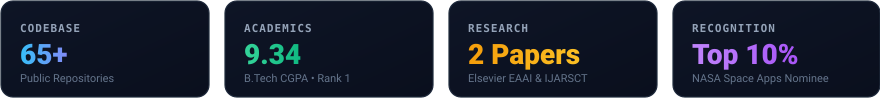

<!-- ==========================================================================
     LAXMI SANAS - PREMIUM DEVELOPER PROFILE DASHBOARD
     Linear / Vercel Dark Theme & Research Journal Dual-Mode Architecture
     ========================================================================== -->

<p align="center">
  <picture>
    <source media="(prefers-color-scheme: dark)" srcset="assets/header-dark.svg">
    <source media="(prefers-color-scheme: light)" srcset="assets/header-light.svg">
    
  </picture>
</p>

<p align="center">
  <a href="https://www.linkedin.com/in/laxmisanas07/">
    
  </a>
  <a href="mailto:laxmiwork0706@gmail.com">
    
  </a>
  <a href="https://github.com/laxmisanas07?tab=repositories">
    
  </a>
  <a href="https://komarev.com/ghpvc/?username=laxmisanas07&color=38bdf8&style=for-the-badge&label=PROFILE+VIEWS">
    
  </a>
</p>

<!-- Metrics Overview Strip (Adaptive Light/Dark Theme) -->
<p align="center">
  <picture>
    <source media="(prefers-color-scheme: dark)" srcset="assets/metrics-dark.svg">
    <source media="(prefers-color-scheme: light)" srcset="assets/metrics-light.svg">
    
  </picture>
</p>

---

## 🧭 System Overview & Executive Summary

```yaml
candidate: Laxmi Sanas
role: AI & Data Science Engineer | Full-Stack Developer | ML Researcher
education:
  degree: B.Tech in Artificial Intelligence and Data Science
  institution: Sandip Institute of Technology & Research Centre (SITRC), Nashik
  standing: Department Academic Topper (1st Rank) • CGPA 9.34 / 10
  expected_graduation: May 2027
specializations:
  - Algorithmic Recourse & Explainable AI (XAI)
  - Predictive Machine Learning & Deep Learning Pipelines
  - Real-Time Cybersecurity Engineering & Packet Inspection
  - Distributed Systems & High-Concurrency Networking
availability: Open to AI/ML Engineering & Software Development Roles (2026–2027)
```

I am an **Artificial Intelligence & Data Science undergraduate** and **systems engineer** with **65+ public repositories** on GitHub. My technical trajectory bridges theoretical machine learning research (authoring papers on counterfactual recourse and nutritional systems) with production software engineering (packet-inspecting firewalls, socket-level peer-to-peer messaging, and scalable web architectures).

---

## 🎓 Education & Academic Foundations

<table>
  <thead>
    <tr>
      <th>Degree / Qualification</th>
      <th>Institution</th>
      <th>Duration</th>
      <th>Performance / Standing</th>
    </tr>
  </thead>
  <tbody>
    <tr>
      <td><strong>B.Tech in Artificial Intelligence &amp; Data Science</strong></td>
      <td>Sandip Institute of Technology &amp; Research Centre (SITRC), Nashik</td>
      <td>2024 – 2027</td>
      <td><strong>CGPA: 9.34 / 10</strong> (Department Academic Rank 1 / Topper)</td>
    </tr>
    <tr>
      <td><strong>Diploma in Computer Engineering</strong></td>
      <td>Shree Mahavir Education Society, Nashik</td>
      <td>2021 – 2024</td>
      <td><strong>Percentage: 87.14%</strong> (First Class with Distinction)</td>
    </tr>
    <tr>
      <td><strong>Secondary School Certificate (SSC)</strong></td>
      <td>CDO Meri Highschool, Nashik</td>
      <td>2011 – 2021</td>
      <td><strong>Percentage: 84.40%</strong></td>
    </tr>
  </tbody>
</table>

---

## 🛠️ Technical Skills & Technology Dashboard

<table>
  <tr>
    <td width="28%" valign="top"><strong>Core Languages</strong></td>
    <td>
      
      
      
      
      
      
      
    </td>
  </tr>
  <tr>
    <td valign="top"><strong>AI, ML &amp; Data Science</strong></td>
    <td>
      
      
      
      
      
      
      
    </td>
  </tr>
  <tr>
    <td valign="top"><strong>Cybersecurity &amp; Systems</strong></td>
    <td>
      
      
      
      
      
    </td>
  </tr>
  <tr>
    <td valign="top"><strong>Web Architecture &amp; Cloud</strong></td>
    <td>
      
      
      
      
      
      
      
    </td>
  </tr>
  <tr>
    <td valign="top"><strong>Developer Toolchain</strong></td>
    <td>
      
      
      
      
      
      
      
    </td>
  </tr>
</table>

---

## 🚀 Featured Engineering Projects

### 🔐 01. Bit-Kavach Encryption Tool
> **Enterprise-grade symmetric cryptographic utility for data integrity and secure file encryption.**

- **Architecture & Implementation:** Built with Python implementing Fernet symmetric encryption and PBKDF2 HMAC-SHA256 key derivation. Provides authenticated encryption with AES-128 in CBC mode and HMAC for ciphertext integrity.
- **Key Features:** File-level encryption/decryption, secure in-memory key generation, tamper detection, CLI interface.
- **Repository:** [`laxmisanas07/Bit-Kavach-Encryption-Tool`](https://github.com/laxmisanas07/Bit-Kavach-Encryption-Tool)
- **Stack:** `Python` `Fernet Cryptography` `PBKDF2` `Data Security`

---

### 🔥 02. Agni Firewall Simulation Engine
> **Rule-based packet filtering and network security analyzer simulating layer 3 & 4 firewall inspection.**

- **Architecture & Implementation:** Developed in Python to model enterprise perimeter defense. Parses synthetic packet streams, evaluates headers against configurable rule matrices (allow/drop/log), and detects IP spoofing patterns.
- **Key Features:** Real-time IP address filtering, port-based access control, protocol verification (TCP/UDP/ICMP), audit logging.
- **Repository:** [`laxmisanas07/Agni-Firewall`](https://github.com/laxmisanas07/Agni-Firewall)
- **Stack:** `Python` `Socket Architecture` `Packet Inspection` `Network Security`

---

### 👁️ 03. Trinetra Network Vulnerability Scanner
> **Multi-threaded network reconnaissance tool for host discovery and exposed port assessment.**

- **Architecture & Implementation:** Engineered in Python using concurrent worker threads to accelerate TCP/UDP connection probing across target subnet ranges without choking bandwidth.
- **Key Features:** Subnet host sweep, multi-threaded port scanner, service banner grabbing, vulnerability risk reporting.
- **Repository:** [`laxmisanas07/Trinetra-Scanner`](https://github.com/laxmisanas07/Trinetra-Scanner)
- **Stack:** `Python` `Multithreading` `Socket Programming` `Vulnerability Assessment`

---

### 🏥 04. Hospital Management System
> **Structured relational database management system for clinical workflows and patient scheduling.**

- **Architecture & Implementation:** Designed with C and Java connected to a normalized MySQL relational schema. Handles ACID-compliant appointment transactions, patient medical histories, billing ledger records, and role-based staff access.
- **Key Features:** Relational schema design, patient record indexing, doctor scheduling engine, report generation.
- **Repository:** [`laxmisanas07/Hospital-Management-System`](https://github.com/laxmisanas07/Hospital-Management-System)
- **Stack:** `C` `Java` `MySQL` `Relational Database Design`

---

### 💬 05. WhatsApp / Messenger LAN Protocol
> **Low-latency peer-to-peer local network messaging system utilizing socket multithreading.**

- **Architecture & Implementation:** Python-based socket messaging server and client architecture that establishes non-blocking TCP connections across local area networks, enabling real-time group broadcasts and direct chats.
- **Key Features:** Concurrent multi-client connection management, message serialization, graceful disconnection handling.
- **Repository:** [`laxmisanas07/WhatsApp-Clone`](https://github.com/laxmisanas07/WhatsApp-Clone)
- **Stack:** `Python` `TCP/IP Sockets` `Multithreading` `Network Protocols`

---

### 🎮 06. JetStorm Galaxy Defender
> **Retro 2D space shooter arcade game featuring enemy wave AI and real-time collision dynamics.**

- **Architecture & Implementation:** Built with Python and Pygame featuring a fixed-timestep game engine loop, custom sprite sheet animations, particle explosion systems, and difficulty-scaling enemy flight patterns.
- **Key Features:** Wave-based AI behavior, sprite collision physics, high-score state persistence, audio management.
- **Repository:** [`laxmisanas07/JetStorm-Galaxy-Defender`](https://github.com/laxmisanas07/JetStorm-Galaxy-Defender)
- **Stack:** `Python` `Pygame` `Game Engine Architecture` `Physics Dynamics`

---

### 🧠 07. QuizWhiz Interactive Testing Engine
> **TypeScript web platform featuring dynamic state-driven quiz mechanics and real-time score analytics.**

- **Architecture & Implementation:** Frontend built with TypeScript and modern React patterns, deployed on Vercel. Implements strictly typed state reducers for timer management, scoring rubrics, and responsive viewports.
- **Live Demo:** [quiz-whiz-laxmi-sanas.vercel.app](https://quiz-whiz-laxmi-sanas.vercel.app)
- **Repository:** [`laxmisanas07/QuizWhiz_LaxmiSanas`](https://github.com/laxmisanas07/QuizWhiz_LaxmiSanas)
- **Stack:** `TypeScript` `React` `Tailwind CSS` `Vercel`

---

## 📑 Peer-Reviewed Research Publications

```
[01] Elsevier EAAI (Under Peer Review)
     Title: Counterfactual Explanations and Actionable Algorithmic Recourse in Credit Scoring:
            A Systematic Review, Taxonomical Synthesis, and Regulatory Roadmap
     Venue: Computers and Electrical Engineering / Elsevier Engineering Applications of Artificial Intelligence
     Focus: Actionable recourse formulations, algorithmic fairness in lending, GDPR Art. 22 compliance.

[02] IJARSCT Journal (Published March 2024)
     Title: Healthful Millets - Dietary Significance in Modern Nutritional Practices
     Venue: International Journal of Advanced Research in Science, Communication and Technology
     DOI/Ref: Volume 4, Issue 1 • Co-Author: Dr. Sucheta Bidve • Link: ijarsct.co.in/Paper15644.pdf
     Focus: Nutritional data synthesis, sustainable agricultural frameworks, digital consumer platform.
```

---

## 📊 Live GitHub Analytics & Development Cadence

<table align="center" width="100%">
  <tr>
    <td width="50%" align="center">
      
    </td>
    <td width="50%" align="center">
      
    </td>
  </tr>
</table>

<details>
  <summary><strong>🔍 Click to expand Repository &amp; Tech Stack Distribution</strong></summary>
  <br/>
  
| Domain | Representative Repositories | Primary Technologies |
| :--- | :--- | :--- |
| **Security &amp; Networking** | `Agni-Firewall`, `Bit-Kavach-Encryption-Tool`, `Trinetra-Scanner` | Python, Cryptography, Sockets |
| **Distributed &amp; Cloud** | `WhatsApp-Clone`, `NexaCompute`, `Super60-Placement-Prep` | Python, Multithreading, Linux |
| **Web &amp; Full-Stack** | `QuizWhiz_LaxmiSanas`, `Hospital-Management-System`, `Namma-Trip` | TypeScript, React, Java, MySQL |
| **Algorithms &amp; DSA** | `C-Programming-Challenge`, `Python-DSA-Mastery` | C, C++, Python, Data Structures |
| **Game &amp; Simulation** | `JetStorm-Galaxy-Defender`, `Quiz-app-Using-Python` | Python, Pygame, Canvas API |

</details>

---

## 🏆 Honors, Competitions & Professional Recognition

- **🚀 NASA Space Apps Challenge Global Nominee** — Ranked among the **Top 10% worldwide** out of **9,000+ international teams**, recognized for space science data visualization.
- **🥇 Department Academic Topper (1st Rank)** — Highest CGPA (**9.34 / 10**) in the Department of Artificial Intelligence & Data Science, SITRC Nashik.
- **🏛️ IIIT Gwalior Hackathon Finalist** — Selected among the **Top 16.6%** of competing engineering teams across India.
- **⚡ 1st Place Winner, Rapid Coding Challenge** — Champion in a competitive 60-Minute Rapid Code Execution competition.
- **💡 Smart India Hackathon (SIH) Internal Finalist** — Qualified through institutional rounds for government/industrial problem statements.
- **🦈 Shark Tank SITRC & SunHacks Finalist** — Pitch and technical prototype finalist for innovation and entrepreneurship.

---

## 📜 Verified Industry Certifications

- **Oracle Certified AI Foundations Associate** — *Oracle Cloud Infrastructure (OCI)*
- **Oracle Certified Generative AI Professional** — *Oracle Cloud Infrastructure (OCI)*
- **Cloud Computing & Distributed Systems** — *NPTEL / IIT (Final Score: 76%)*
- **Anthropic Claude 101** — *Anthropic Credential ID: `5gydvtybsbfh`*
- **5-Day AI Agents Intensive Course** — *Google & Kaggle*
- **5-Day AI Agents Intensive Course with Google** — *Kaggle & Google*
- **AWS Solutions Architecture & Tata GenAI Job Simulations** — *AWS / Tata / Forage*

---

## 💼 Industry Internships & Experience

- **Artificial Intelligence Intern** — *INTERNINFOBYTE.IN* *(Nov 2026 – Present | Remote)*
  - Developed predictive AI pipelines in Python; implemented data cleaning, feature preprocessing, model evaluation, and regression forecasting.
- **Generative AI & Agentic Systems Intern** — *Lenovo India* *(Jun 2026 – Oct 2026 | Remote)*
  - Architected autonomous agentic workflows using n8n and Large Language Models (LLMs) to automate task orchestration, tool calling, and API pipeline execution.
- **Logistics Data Analyst Intern** — *YuvaIntern* *(Aug 2026 – Sep 2026 | Remote)*
  - Performed data preprocessing, exploratory data analysis, and predictive regression modeling in Python (Pandas, NumPy, Scikit-learn).
- **Web Development Intern** — *SoftCrowd Technologies* *(Jun 2023 – Nov 2023 | Nashik, India)*
  - Built responsive front-end user interfaces and interactive components using HTML5, CSS3, and JavaScript.

---

## 🤝 Connect & Collaborate

<p align="center">
  <a href="https://www.linkedin.com/in/laxmisanas07/">
    
  </a>
  <a href="mailto:laxmiwork0706@gmail.com">
    
  </a>
  <a href="https://github.com/laxmisanas07">
    
  </a>
</p>

```
📍 Location: Nashik, Maharashtra, India
💼 Work Inquiries: laxmiwork0706@gmail.com
🌐 Focus Areas: AI/ML Engineering, Distributed Systems, Software Engineering, Recourse Modeling
```

---

<p align="center">
  <sub>Designed with architectural precision • <strong>Laxmi Sanas</strong> © 2026 • Production-Ready Developer Dashboard</sub>
</p>
